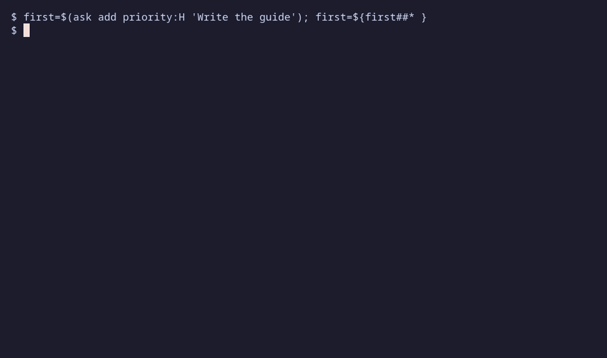

# 10. Project tasks with ask

[← Tmux status](09-tmux.md) · [Contents](index.md) · [Next: Files and troubleshooting →](11-troubleshooting.md)

`ask` wraps Taskwarrior for project work. It filters tasks to the current
git project and the `agent` tag, and gives them stable short aliases. It
makes no LLM calls. Install Taskwarrior and put `task` on your PATH first.


The animation uses a temporary Taskwarrior database. Commands in your own
shell use your normal Taskwarrior configuration and data.

## Start with a task

Inside the `hexai-demo` repository from chapter 1:

```sh
ask add priority:H 'Document Add'
ask ready
```

The first command prints `created task <alias>`. Copy that alias for later
commands; below, replace `abc` with yours:

```sh
ask start abc
ask info abc
ask annotate abc 'Document the return value and integer overflow behavior.'
ask info
ask stop abc
ask start abc
ask done abc
```

`ask info` without a selector shows the current started task when one is
unambiguous. `start` and `stop` track work in progress. `done` marks it complete;
use it after the actual work is finished.

Aliases are stored in a local cache. They replace Taskwarrior numeric IDs in
human-facing output. Selectors also accept UUIDs, and `uuid:<uuid>` forces
UUID interpretation when a value is ambiguous. `ask info` hides raw UUIDs
unless `HEXAI_DEBUG` is set. Use the alias shown in your output, rather than
copying an example alias or numeric Taskwarrior ID.

## Hierarchical project names

The scope comes from the git repository basename plus the path below its
root, with directory separators converted to dots:

| Working directory | Project stamped by `ask add` |
|-------------------|------------------------------|
| `~/git/hexai-demo` | `hexai-demo` |
| `~/git/hexai-demo/docs` | `hexai-demo.docs` |
| `~/git/hexai-demo/docs/examples` | `hexai-demo.docs.examples` |

`add` stamps the exact current project. Read commands include it and its
descendants: the repository root sees all those tasks; `docs` sees docs and
docs.examples, but excludes parent and sibling projects. Unrelated names
such as `hexai-demo-other` do not match. Dots in directory names are ambiguous
in Taskwarrior's hierarchy, so prefer names without dots when using this
convention. Existing tasks scoped only to the repository name still appear
from its root.

Override the project when working elsewhere:

```sh
ask proj:hexai-demo list
ask proj:hexai-demo.docs add 'Check examples'
```

`ask` needs a git repository unless you supply `proj:<name>`.



## Agent and personal tasks

The default scope includes `+agent`. Prefix with `na` or `no-agent` to use
project tasks without that tag:

```sh
ask na add 'Read through the guide myself'
ask na list
ask proj:hexai-demo na list
ask na proj:hexai-demo list
```

The prefixes can appear in either order. `ask projects` is global: it lists
projects with pending, not-yet-started work, including hierarchical project
names. It does not create parent names just because a child has work.

## Find the next task

```sh
ask list start.any: sort:priority-,urgency-
ask ready sort:priority-,urgency-
ask list +BLOCKED
ask list +docs limit:5
ask urgency
ask all
```

`list` shows pending tasks in the current scope, `ready` selects actionable
ones, and `all` also includes completed/deleted tasks. `started` is a shortcut
filter for started tasks. `+tag`, `limit:N`, and `sort:` narrow or order the
listing. A useful work order is to resume started tasks, then choose by
priority and urgency.

Watch a read command refresh every two seconds; Ctrl-C stops the display:

```sh
ask watch
ask watch ready
ask projects +docs
```

## Dependencies, priorities, and updates

Create a second task, copy its alias, and use those aliases in the commands
below. For illustration, `abc` is the prerequisite and `def` depends on it:

```sh
ask add depends:abc 'Review the Add documentation'
ask dep list def
ask dep add def abc
ask dep rm def abc
ask priority def M
ask tag def +docs
ask tag def -docs
ask annotate def 'Check the overflow example.'
ask denotate def 'Check the overflow example.'
ask modify def priority:L
ask edit def
```

Inline dependencies can contain several comma-separated aliases or UUIDs,
for example `depends:abc,def`. Blocked tasks become ready after their
prerequisites are completed. `edit` opens the configured editor on a temporary file containing the task
description; `modify` passes supported task modifiers through. `ask delete def`
deletes the selected task when that is what you intend. `ask edit` without
a selector opens your editor to create a new task from its contents.

## Due dates and completed work

`ask list` normally hides tasks due more than a week away while retaining
undated tasks. Use an explicit window to see further ahead:

```sh
ask add due:2026-12-01 'Review the guide in December'
ask ready due-window:2.months
ask list due-within:7.days
ask completed since:today
ask completed since:7.days
ask completed since:this.month
```

`due-within:` selects tasks due by the end of the interval, including overdue
tasks. `due-window:` also includes undated tasks. These work with `list`,
`all`, `ready`, `completed`, and `projects` where applicable. `since:` on
completed tasks accepts `today`, `this.week`, `this.month`, and intervals
such as `24.hours`, `7.days`, or `2.months`. Raw Taskwarrior date-attribute
filters are also supported; absolute dates avoid version-dependent relative
filter parsing.

## JSON for scripts

Read commands support the global `--json` flag:

```sh
ask --json ready
ask --json info abc
ask --json projects
```

Task JSON includes alias IDs and UUIDs for machine consumers. Write commands
keep their normal compact success messages. Use an explicit subcommand rather
than passing free text: `ask add 'description'` creates a task.

## Fish completion

Load the completion script from the installed binary:

```fish
ask fish | source
```

For future sessions, create `~/.config/fish/conf.d/ask.fish` (or the same
path under `$XDG_CONFIG_HOME`):

```fish
set -l ask_bin ~/go/bin/ask
if test -x $ask_bin
    $ask_bin fish | source
end
```

Change `ask_bin` if you installed elsewhere. Completion covers subcommands,
`dep` operations, project prefixes, task aliases, and comma-separated
`depends:` selectors. It stops offering selectors once a command has
consumed them. The global `--json` flag is preserved by the completion script.

The binaries do not install static files under `fish/completions/`. If an
older release left `~/.config/fish/completions/ask.fish`, remove that obsolete
file and load the embedded script instead so completions match your binary.

For scripts, `ask complete-aliases` emits pending alias suggestions;
`ask complete-uuids` emits aliases and UUIDs. Use `ask help` for the complete
command help. The binary was briefly called `do`; use `ask` in new commands.
