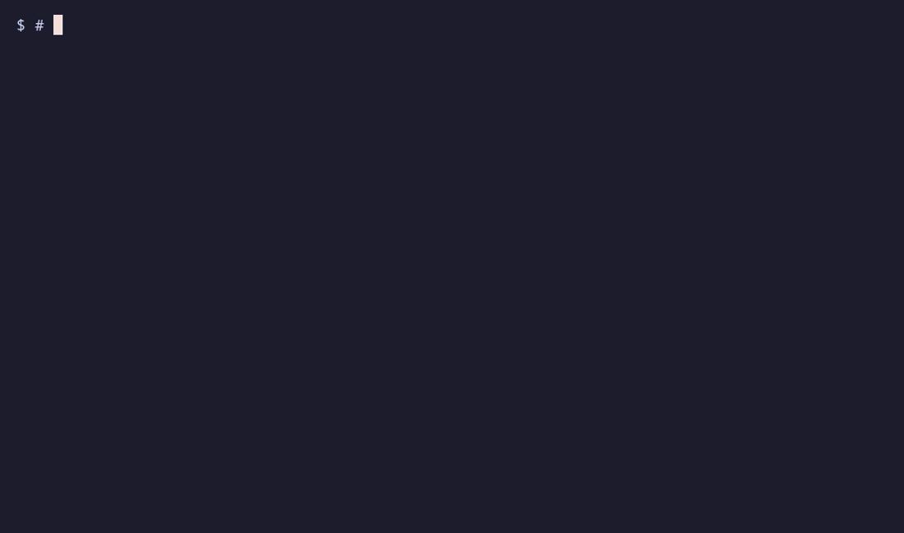
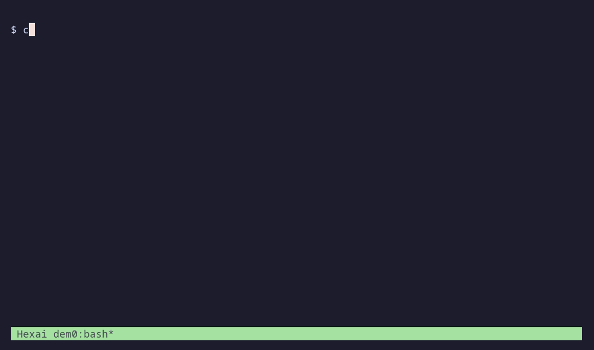
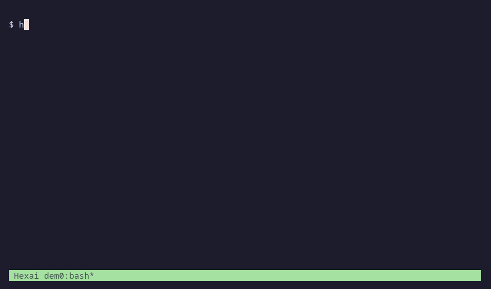

# The Hexai guide

A book about using Hexai, from your first command to an editor that completes
code, answers questions, and changes a selection for you. Each chapter explains
the feature, gives you something to try, and shows it running in a terminal.
Read in order to set everything up, or jump to the tool you need.


## Chapters

| # | Chapter | What you will do |
|---|---------|------------------|
| 1 | [Installing](#1-installing) | Install the four binaries, Helix, tmux, and Taskwarrior; build from source |
| 2 | [Your first configuration](#2-your-first-configuration) | Choose local or cloud inference; edit settings and override them per project |
| 3 | [The command line](#3-the-command-line) | Ask questions, pipe files, open your editor, cache replies, and simulate streaming |
| 4 | [Models and providers](#4-models-and-providers) | Choose a model per feature, compare providers, and configure fallback |
| 5 | [Completions in Helix](#5-completions-in-helix) | Register the LSP server, request completions, and control context and ignored files |
| 6 | [Chat and inline prompts](#6-chat-and-inline-prompts) | Ask follow-up questions inside a file, replace prompt tags, and reload settings |
| 7 | [Code actions](#7-code-actions) | Rewrite, document, fix diagnostics, generate Go tests, and use the tmux action menu |
| 8 | [Your own actions and prompts](#8-your-own-actions-and-prompts) | Add reusable actions, replace the menu, and customize prompt templates |
| 9 | [Tmux status](#9-tmux-status) | Show live requests and usage statistics; set colors and width |
| 10 | [Project tasks with ask](#10-project-tasks-with-ask) | Scope tasks, manage dependencies and dates, watch progress, and enable Fish completion |
| 11 | [Files and troubleshooting](#11-files-and-troubleshooting) | Find logs and caches, diagnose failures, and run development checks |

## Following along

Examples use a small Go function, `Add`, and a git repository called
`hexai-demo`. The CLI and task chapters work without an editor. Code completion,
chat, and actions need a configured provider; `ask` needs Taskwarrior but no LLM.
Shell examples use Bash unless a block says `fish`, `toml`, or `tmux`.

The recordings run the **real Hexai binaries**, Helix, tmux, and Taskwarrior.
LLM replies come from a deterministic **local HTTP fixture**, so they demonstrate
the interaction without requiring credentials or making paid API calls. The
`demo-fast` and `demo-careful` names in the animations are fixture names, not
models to install. Real provider replies, timing, versions, and task aliases
will differ. The TPS simulation in chapter 3 is Hexai's own offline mode.

Every chapter includes commands and explanations so you can follow it without
playing the animation. Click a GIF to open it if your viewer pauses animations.

The [commented configuration file](../../config.toml.example) is the complete
option reference. This guide covers the maintained tools; the experimental
MCP server keeps its [separate archival documentation](../mcp-setup.md).

## 1. Installing

Hexai ships four maintained programs. Install only the ones you need:

| Program | What it does | Extra runtime tools |
|---------|--------------|---------------------|
| `hexai` | Send prompts and piped text to an LLM | A provider; an editor for interactive input |
| `hexai-lsp-server` | Completions, chat, and code actions over stdio LSP | Helix or another LSP client; a provider |
| `hexai-tmux-action` | Apply actions to a piped selection through a popup | tmux; a provider for actions that call an LLM |
| `ask` | Manage tasks in the current git project | git and Taskwarrior (`task` on your PATH) |


### Install with Go

Use Go 1.26 or newer, matching this repository's `go.mod`.

```sh
go install github.com/snonux/hexai/cmd/hexai@latest
go install github.com/snonux/hexai/cmd/hexai-lsp-server@latest
go install github.com/snonux/hexai/cmd/hexai-tmux-action@latest
go install github.com/snonux/hexai/cmd/ask@latest
```

`go install` writes to `$GOBIN` when set, otherwise the `bin` directory in your
GOPATH (normally `~/go/bin`). Add that directory to PATH, including the PATH
seen by Helix and tmux. For a default Bash setup:

```sh
export PATH="$HOME/go/bin:$PATH"
hexai --version
hexai-lsp-server --version
hexai --help
ask help
```

Install Helix and tmux through your operating system's package manager if you
want the editor workflow. Install Taskwarrior for `ask`. Fish is optional and
only needed for [Fish completion](#fish-completion).

### Build a checkout

```sh
git clone https://github.com/snonux/hexai.git
cd hexai
go install github.com/magefile/mage@latest
mage build
mage install
```

`mage build` creates `ask`, `hexai`, `hexai-lsp-server`, and
`hexai-tmux-action` at the repository root. `mage install` builds and copies
them to `$GOPATH/bin`, defaulting to `~/go/bin` when GOPATH is unset.
It does not write Fish completion files. To keep the build in your checkout,
call a binary with `./hexai` instead.

You can build the programs directly with Go, for example
`go build -o hexai ./cmd/hexai`. The [last chapter](#development-checks)
covers the test, formatting, and coverage commands.

### Make a place to experiment

```sh
mkdir hexai-demo
cd hexai-demo
git init
printf 'func Add(a, b int) int { return a + b }\n' > selection.go
```

This repository name will also become the default `ask` project name.
Next, [choose a provider](#2-your-first-configuration) before sending your first prompt.

## 2. Your first configuration

Hexai reads a sectioned TOML file. Start with a small configuration and add
the parts you use; [config.toml.example](../../config.toml.example) lists
all supported sections and their comments.


The animation points at a local response fixture. Use one of the real
provider configurations below on your own machine.

### Open the file

The default path is `~/.config/hexai/config.toml`, or
`$XDG_CONFIG_HOME/hexai/config.toml` when XDG_CONFIG_HOME is set.

```sh
export HEXAI_EDITOR=hx
hexai config
```

`HEXAI_EDITOR` takes precedence over `EDITOR`. Save your TOML and exit the
editor to return to the shell. You can also open a different file:

```sh
hexai --config ./my-config.toml config
hexai --config ./my-config.toml 'What is a slice in Go?'
```

### Use Ollama Cloud

The built-in provider is Ollama Cloud at `https://ollama.com`, with
`minimax-m3:cloud` for general use and `qwen3-coder:480b-cloud` for completions.
Provide your Ollama API key through the environment. The key variables are
`HEXAI_OLLAMA_API_KEY`, falling back to `OLLAMA_API_KEY`.

This makes the provider choice explicit:

```toml
[provider]
name = "ollama"

[ollama]
base_url = "https://ollama.com"
model = "minimax-m3:cloud"
temperature = 0.2
```

Pick models available to your account. The model names here describe the
repository's defaults rather than a promise about a provider's model catalog.

### Use a local Ollama server

With an Ollama server running and a coding model installed, set both the
general model and the completion model. Use the exact tag from your local
`ollama list`; substitute it for `your-local-model` in both places:

```toml
[provider]
name = "ollama"

[ollama]
base_url = "http://localhost:11434"
model = "your-local-model"

[models.completion]
provider = "ollama"
model = "your-local-model"
temperature = 0.0
```

Localhost Ollama needs no API key. Setting the completion entry matters:
otherwise the built-in completion model remains the cloud model.

### Hosted providers

| Provider name | Config section | Preferred key variable | Fallback key variable |
|---------------|----------------|------------------------|-----------------------|
| `ollama` | `[ollama]` | `HEXAI_OLLAMA_API_KEY` | `OLLAMA_API_KEY` |
| `openai` | `[openai]` | `HEXAI_OPENAI_API_KEY` | `OPENAI_API_KEY` |
| `openrouter` | `[openrouter]` | `HEXAI_OPENROUTER_API_KEY` | `OPENROUTER_API_KEY` |
| `anthropic` | `[anthropic]` | `HEXAI_ANTHROPIC_API_KEY` | `ANTHROPIC_API_KEY` |

For example, after making your OpenAI key available in the environment:

```toml
[provider]
name = "openai"

[openai]
model = "gpt-4.1"
base_url = "https://api.openai.com/v1"

[models.completion]
provider = "openai"
model = "gpt-4.1"
temperature = 0.0
```

The provider name selects the implementation; `base_url` selects its endpoint.
The same pattern applies to `[openrouter]` and `[anthropic]`; copy their
section from the example file and choose a model supported by your account.
Keep credentials in environment variables rather than project TOML.

### Share project settings

Create `.hexaiconfig.toml` at the git repository root to override only the
settings that differ for that project:

```toml
[general]
context_mode = "window"
context_window_lines = 60

[completion]
completion_debounce_ms = 1000
```

Hexai searches upwards from its working directory for `.git`, including
worktree `.git` files. Start Helix from the intended project so its server
finds that root. The merge order is:

1. Built-in defaults.
2. Global TOML, or the file selected with `--config`.
3. Project `.hexaiconfig.toml`.
4. Supported environment overrides.

`--config` changes the global-file layer; project settings and environment
overrides still apply. `hexai`, `hexai-lsp-server`, and `hexai-tmux-action`
accept `--config`. `ask` manages Taskwarrior settings separately.

### Environment overrides

Use environment overrides for a single session or command:

```sh
HEXAI_CONTEXT_MODE=window HEXAI_CONTEXT_WINDOW_LINES=40 hexai 'Explain slices'
HEXAI_PROVIDER_CLI=openai HEXAI_MODEL_CLI=gpt-4.1 hexai 'Explain slices'
```

Common variables include `HEXAI_PROVIDER`, `HEXAI_MAX_TOKENS`,
`HEXAI_MAX_CONTEXT_TOKENS`, `HEXAI_REQUEST_TIMEOUT` (seconds),
`HEXAI_CODING_TEMPERATURE`, `HEXAI_COMPLETION_DEBOUNCE_MS`,
`HEXAI_COMPLETION_THROTTLE_MS`, and `HEXAI_LOG_PREVIEW_LIMIT`.
Provider model, URL, and temperature use names such as `HEXAI_OPENAI_MODEL`,
`HEXAI_OPENAI_BASE_URL`, and `HEXAI_OPENAI_TEMPERATURE`.

The supported overrides are explicit; do not assume every TOML key has an
environment equivalent. [Models and providers](#4-models-and-providers) covers the
per-feature model and provider variables. After editing a running LSP's
configuration, use [reload or restart](#slash-commands).

## 3. The command line

Use `hexai` whenever text is already in your shell: a question, a file,
or output from another command. It writes answers to stdout so you can pipe
or save them, while provider labels and request summaries go to stderr.


### Ask a question

With your provider configured:

```sh
hexai 'What is a slice in Go?'
hexai 'show a command to find Go files'
hexai 'explain when a slice allocates a new backing array'
```

The default system prompt asks for concise replies. A request for commands
asks the model to return commands only. Including `explain` switches to a
more detailed system prompt. These are model instructions, so review the
answer before using it.

Put flags before the prompt. `hexai --help` lists the numbered provider flags
for your current configuration, alongside `--config`, `--version`, and
`--tps-simulation`.

### Pipe a file or another command

```sh
cat selection.go | hexai
cat selection.go | hexai 'explain this function'
git diff | hexai 'summarize the changes in three bullets'
hexai 'show a command to find Go files' > command.txt
cat command.txt
```

When you provide stdin and arguments together, Hexai constructs the request
as `argument text`, a colon and blank line, then the stdin text. With no
arguments, piped stdin becomes the prompt by itself.

Only the text you pass is CLI input; `hexai` does not automatically attach
your repository. Editor context settings apply to the LSP workflow in
[chapter 5](#5-completions-in-helix).

### Write the prompt in your editor

Run `hexai` from a terminal with no arguments or piped input. It opens a
temporary Markdown file in `HEXAI_EDITOR`, falling back to `EDITOR`.
Write a prompt, save it, and close the editor to send it.

```sh
export HEXAI_EDITOR=hx
hexai
```

If no usable text comes back, the command reports an input error. Temporary
editor files use the system temporary directory and are cleaned up after use.
`hexai config` opens configuration instead of an LLM prompt.

### Reuse an answer

Successful answers are cached for 24 hours in Hexai's cache directory.
The key includes the input, provider, resolved model, and effective CLI
system prompt. Changing any of those yields a different entry.

```sh
hexai 'What does Add do?'
hexai 'What does Add do?'
```

The second run can reuse the first answer. For a comparison with several
models, select a single numbered entry on the rerun to get one clean answer
on stdout. [Chapter 4](#compare-several-models) demonstrates this.
Provider labels and summaries stay on stderr even when a reply is cached.

### Preview output speed offline

TPS simulation streams supplied text without contacting an LLM. This is
useful for getting a feel for a model's response rate before running it.

```sh
hexai --tps-simulation 20
hexai --tps-simulation 12-18 'A short answer at a variable rate.'
cat selection.go | hexai --tps-simulation 20
```

Use a positive fixed rate, or a positive ordered range such as `12-18`.
Without supplied text, Hexai streams built-in placeholder text. It is a
speed preview, not a measurement of a provider's actual token throughput.

### Exit status

| Status | Meaning |
|--------|---------|
| `0` | Successful response, simulation, config editing, or version output |
| `1` | Runtime error, including missing input, provider failure, or invalid simulation rate |
| `2` | Flag parsing error, including an unknown flag (`--help` also currently returns `2`) |

If a shell pipeline needs to report errors from any stage, enable
`set -o pipefail`. [Troubleshooting](#11-files-and-troubleshooting) covers missing
keys, unreachable endpoints, and finding the cache.

## 4. Models and providers

A quick completion and a long explanation need different things from a
model. Hexai lets you configure each surface independently: `completion`,
`code_action`, `chat`, and `cli`.


The animation uses two local fixture models. In the examples below, replace
model names with models available through your providers.

### Choose a model per surface

Add entries to the configuration from chapter 2:

```toml
[models.completion]
provider = "openai"
model = "gpt-4.1-mini"
temperature = 0.0

[models.code_action]
provider = "openai"
model = "gpt-4.1"
temperature = 0.2

[models.chat]
provider = "ollama"
model = "minimax-m3:cloud"

[models.cli]
provider = "ollama"
model = "minimax-m3:cloud"
```

The provider's own section supplies its base URL and default settings.
A shorthand such as `[models]` with `cli = "minimax-m3:cloud"` selects only
the model and uses the general provider. Use the table form when choosing
a different provider or temperature. Do not define both forms for the same
surface in one TOML file.

Environment equivalents use `HEXAI_MODEL_COMPLETION`, `HEXAI_MODEL_CODE_ACTION`,
`HEXAI_MODEL_CHAT`, and `HEXAI_MODEL_CLI`. Replace `MODEL` with `PROVIDER` or
`TEMPERATURE` to override those fields instead. For example:

```sh
HEXAI_PROVIDER_CLI=openai HEXAI_MODEL_CLI=gpt-4.1 hexai 'Explain slices'
```

### Compare several models

Array tables configure several entries for the same surface. Replace an
existing single `[models.cli]` table with these blocks:

```toml
[[models.cli]]
provider = "openai"
model = "gpt-4.1-mini"

[[models.cli]]
provider = "ollama"
model = "minimax-m3:cloud"
```

```sh
hexai 'What does Add do?'
hexai -0 'What does Add do?'
hexai -1 'What does Add do?'
```

The first command calls every CLI entry concurrently and displays the replies
side by side. Flags `-0`, `-1`, and so on select entries by their zero-based
configuration order. Combine flags to choose a subset. Selecting one entry
prints a single response, suitable for a pipe; an identical rerun can use its
cached answer.

`[[models.completion]]` works similarly for LSP suggestions, labeling results
with `provider:model`. `[completion] completion_wait_all = true` waits for
all completion backends; `false` returns the first result.
Code actions use the **first entry only**, logging a warning about extras.
Treat chat as a single configured entry as well; comparison is supported for
the CLI and completions.

### Name endpoints

Profiles let you configure several endpoints of the same provider type:

```toml
[providers.ollama-cloud]
type = "ollama"
base_url = "https://ollama.com"
model = "minimax-m3:cloud"

[providers.ollama-local]
type = "ollama"
base_url = "http://127.0.0.1:11434"
model = "your-local-model"

[[models.cli]]
provider = "ollama-cloud"
fallback_provider = "ollama-local"
fallback_model = "your-local-model"
```

Copy all three blocks together, replacing any earlier CLI entry for this
example. Substitute an installed local model tag in both local-model fields.
The `type` selects the provider implementation; the profile name is how a
surface refers to the endpoint. Credentials use the normal variables for
that provider type. Local Ollama needs no key.

### Recover from a provider outage

`fallback_provider` supplies a second target for one surface entry.
`fallback_model` is optional; when omitted, the fallback profile's model is
used. The fallback runs **after** an eligible primary failure, such as quota
exhaustion, rate limiting, a server error, or a transport failure.

Fallback is sequential and produces one result for that entry. It does not
add another comparison column. Invalid input, authentication failures, and
user cancellation do not trigger fallback. Once streaming has emitted output,
Hexai avoids joining a second model's output onto the partial first answer.
Successful usage is recorded under the provider and model that answered.



To try recovery yourself, configure an unreachable primary local endpoint
and a working fallback, then send a new uncached CLI prompt. A cached success
will bypass the provider call. The complete cloud/local example is also in
[config.toml.example](../../config.toml.example).

## 5. Completions in Helix

`hexai-lsp-server` speaks LSP over stdin and stdout. Helix starts it for you
and can run it alongside your usual language server. Keep `gopls` for Go
navigation and diagnostics; add Hexai for model suggestions and actions.


### Register the server

Add this to `~/.config/helix/languages.toml` (or the matching file below
`$XDG_CONFIG_HOME`). Merge the settings into any language entry you already
have:

```toml
[language-server.hexai]
command = "hexai-lsp-server"

[[language]]
name = "go"
language-servers = ["gopls", "hexai"]

[[language]]
name = "markdown"
language-servers = ["hexai"]
```

`gopls` must be installed separately if you list it. For a minimal setup, use
`language-servers = ["hexai"]`, as the recording does. Add Hexai to other
language entries in the same way; general completions and chat work beyond
Go, while the function-to-test action is Go specific.

The server accepts `--config /path/to/config.toml`, `--log /path/to/log`,
and `--version`. Pass server flags with Helix's `args` setting:

```toml
[language-server.hexai]
command = "hexai-lsp-server"
args = ["--config", "/absolute/path/to/config.toml"]
```

Use one server definition, choosing either the default file or explicit args.
Start Helix from your project root, then run `hx --health go` from the same
shell if the server is not found. Existing Helix sessions may need a language
server restart after you change `languages.toml`.

### Ask for a completion

Create `add.go`:

```go
package demo

func Add(a, b int) int {
    return
}
```

Place the cursor after `return` in insert mode and add a space. Press `Ctrl-x` to request a
completion, use `Ctrl-n`/`Ctrl-p` to choose a suggestion, and Enter to accept.
The animation turns off Helix's automatic completion to make the manual
request easy to see.

Helix normally requests completions while you type. Hexai recognizes
configured trigger characters; it can also suggest parameter-list contents
inside a function signature. With several configured completion entries,
suggestions carry provider/model labels.

### Control request frequency

```toml
[completion]
completion_debounce_ms = 800
completion_throttle_ms = 0
manual_invoke_min_prefix = 0
completion_wait_all = true

[triggers]
trigger_characters = [".", ":", "/", "_", " "]
```

Debounce waits for idle time before requesting. Throttle limits request
frequency; zero disables it. The manual prefix setting requires that many
identifier characters before a manual request. You can also disable automatic
completion through the [chat command](#slash-commands)
without disabling chat and actions.

### Choose the context sent to the model

```toml
[general]
context_mode = "window"
context_window_lines = 60
max_context_tokens = 4000
max_tokens = 4000
request_timeout = 600
coding_temperature = 0.2
```

| Mode | Additional document context |
|------|-----------------------------|
| `minimal` | Only the request's immediate payload |
| `window` | A window around the cursor, controlled by `context_window_lines` |
| `file-on-new-func` | The full file when starting a new function |
| `always-full` | The full open file (the built-in default) |

`max_context_tokens` bounds additional context; `max_tokens` bounds requested
output. Context token counting is an estimate. Choose the mode to suit your
provider and file size. Hexai includes Go function context where applicable;
it is not a repository index.

### Ignore files

```toml
[ignore]
gitignore = true
extra_patterns = ["*.min.js", "vendor/**", "*.generated.go"]
lsp_notify_ignored = true
```

By default normal completions and code actions respect `.gitignore`.
Add patterns to skip those requests, and control whether ignored-file
completions explain the skip. Chat and inline prompts triggered by document
changes still run in ignored files; these patterns do not prevent sending
those prompts. Environment equivalents are `HEXAI_IGNORE_GITIGNORE`,
`HEXAI_IGNORE_EXTRA_PATTERNS` (comma-separated), and `HEXAI_IGNORE_LSP_NOTIFY`.

Next, [ask a question directly inside the file](#6-chat-and-inline-prompts).

## 6. Chat and inline prompts

Chat answers a question below the line you typed. Inline prompts replace a
marker with generated code. Both use the LSP setup from chapter 5.


### Ask inside a file

Open a Markdown file in Helix and type:

```text
What is a slice in Go?>
```

The suffix `?>` triggers chat. The other built-in endings are `!>`, `:>`,
and `;>`. Once answered, Hexai removes just the final `>` from your question
and inserts the reply below it, with a blank line on either side:

```text
What is a slice in Go?

> A slice is a view of an array, with a length and capacity.

```

Every answer line starts with `>`, including multiline replies. Save the file
if you want to keep the exchange. The recording uses Markdown, but questions
can also appear in code comments:

```go
// Why does appending to this slice allocate?>
```

The answer is inserted as quoted text; in a source file you may need to
comment or remove it before compiling.

### Ask a follow-up

Below the answer, type `What is capacity?>`. Hexai includes up to the three
most recent question/answer pairs above the question, so a follow-up can
refer to the preceding exchange.

A question is sent once while its request is in flight. You can keep typing;
Hexai follows the question if earlier lines move. Editing the question itself
causes a stale answer to be dropped and the edited question to be handled
instead. Identical questions on separate lines are answered one after another.
If an answer is already present below a question, Hexai avoids answering it again.

When a request fails, Helix shows a Hexai warning. Edit the question line,
for example by removing and retyping the final `>`, to retry.

### Replace an inline instruction

Inside Go's `Add`, type this and request a completion if your editor has not
already requested one:

```go
return >!return the sum of a and b>
```

The prompt tag is replaced with the model's result:

```go
return a + b
```

Use `>>!instruction>` to replace the **entire current line** instead:

```text
>>!write a Go return statement that adds a and b>
```

The inline forms are strict: no space after `>!` and no space before the
closing `>`. Spaces inside the instruction are fine. A spaced form such as
`> instruction >` is ignored. Inline results are applied only while the tag
still matches; editing or deleting the tag drops the stale result.

### Slash commands

These commands run locally through the same chat mechanism:

| Type on a line | Effect |
|----------------|--------|
| `/help>` | Show available commands |
| `/reload>` | Reload configuration from disk |
| `/disable>` | Disable automatic completions for this LSP session |
| `/enable>` | Enable completions again |

The help replies also show forms such as `/reload?>`; both forms work.
Only a slash followed by a letter starts a command, so a `// question?>`
comment is treated as a question.

Reload reuses the selected config path and project config, but **ignores
environment overrides** during that reload. Restart the language server to
load environment overrides again. Disabling completions leaves chat and code
actions usable.

### Change the markers

```toml
[inline]
inline_open = ">!"
inline_close = ">"

[chat]
chat_suffix = ">"
chat_prefixes = ["?", "!", ":", ";"]
```

The closing marker, chat suffix, and individual chat prefixes are single
characters. Environment equivalents are `HEXAI_INLINE_OPEN`,
`HEXAI_INLINE_CLOSE`, `HEXAI_CHAT_SUFFIX`, and `HEXAI_CHAT_PREFIXES`
(comma-separated). Keep the defaults while learning the workflow.

## 7. Code actions

Use a code action when you have a selection to transform. The LSP exposes
actions through Helix's action picker; `hexai-tmux-action` gives a separate
menu with more built-in transformations and a free-form prompt editor.


### Use the LSP action picker

In Helix, select code and press Space, then `a`. Available actions depend on
the file and selection:

| Action | What Hexai changes |
|--------|--------------------|
| Rewrite selection | Rewrites selected code according to an instruction found in it |
| Resolve diagnostics | Edits the selection to address diagnostics overlapping it |
| Implement unit test (Go) | Generates a `Test*` for the function under the cursor in a `.go` file |
| Document code | Adds documentation to the selected code |
| Simplify and improve | Simplifies the selected code while preserving behavior |
| Custom actions | Runs the user-defined actions from chapter 8 |


For rewrite, put the instruction in the selection itself:

```go
// simplify this function
func Add(a, b int) int {
    result := a + b
    return result
}
```

Instruction extraction checks strict `;instruction;` markers, single-line
`/* instruction */` and `<!-- instruction -->` blocks, and line comments
such as `//`, `#`, and `--`. Keep the instruction near the start of the
selection. A strict semicolon marker has no space after the opening `;`.

Resolve diagnostics uses diagnostics that overlap the range, including those
published by another language server such as `gopls`. Diagnostics elsewhere
are outside the edit. Rewrites preserve leading selection indentation and
its trailing newline. A failed request produces an editor warning.

### Generate Go tests

Place the cursor in a Go function and choose the unit-test action. Hexai
creates the sibling `<file>_test.go` with a package and `testing` import if
needed, or appends test functions when the file already exists.

Review the generated cases and imports, then run `go test ./...` in your
project. Check error cases and boundaries as well as the example input; a
model can produce a plausible test with the wrong expectation.

### Use the tmux action menu

Start tmux, then pipe text to the runner:

```sh
printf 'The functoin retunrs teh sum of two intergers.\n' > notes.txt
cat notes.txt | hexai-tmux-action
```

It opens a tmux popup. Press `f` to proofread the text. The chosen result
returns to stdout after the popup closes. The animation then pipes the Add
function through `c`, Document code.

| Hotkey | Action |
|--------|--------|
| `r` | Rewrite selection using an embedded instruction |
| `i` | Simplify and improve |
| `c` | Document code |
| `t` | Generate Go unit tests |
| `f` | Fix typos, grammar, and clarity |
| `p` | Custom prompt, entered in your editor |
| `s` | Skip, returning the selection |
| `a` | Custom actions submenu, when configured (default submenu key) |

Arrow keys or `j`/`k` move through the menu, `g`/`G` jump to the first/last
entry, and Enter chooses. Escape or `q` skips. The prompt editor uses
`HEXAI_EDITOR` or `EDITOR` and a temporary Markdown file.

The next recording runs Rewrite, Simplify, Go tests, and an editor-entered
custom prompt in sequence:



### Bind the menu in Helix

Run Helix inside tmux and add to `~/.config/helix/config.toml`:

```toml
[keys.select]
"A-a" = ":pipe hexai-tmux-action"

[keys.normal]
"A-a" = ["select_line", ":pipe hexai-tmux-action"]
```

Select text and press Alt-a to choose an action; Helix replaces the selection
with stdout. In normal mode this binding selects the current line first.
For generated tests, prefer the LSP action when you want the sibling test
file created automatically; the TUI returns text for the pipe to apply.

### Files, diagnostics, and popup options

The normal parent process reads **stdin** and manages temporary files for
the popup child. To process a file and save the result, use redirection to a
different destination:

```sh
hexai-tmux-action < input.go > output.go
```

`--infile` and `--outfile` belong to child mode (`--ui-child`); the popup
parent supplies them internally. They do not replace stdin/stdout in the
normal popup invocation. To run the same TUI directly in a terminal without
a popup, use its child path explicitly:

```sh
hexai-tmux-action --ui-child --infile input.go --outfile output.go
```

Advanced flags include `--tmux-target`, `--tmux-popup-width` (default `60%`),
and `--tmux-popup-height` (default `50%`). `--config` selects an alternate
configuration. When piping into the popup workflow, the parent's alternate
config path is not forwarded to the child; use the global or project file
for shared popup settings.

Input can include a `Diagnostics:` header, one diagnostic per line, a blank
line, then the code. That format provides diagnostic context to actions
that use it. Without the header, all input is the selection.

## 8. Your own actions and prompts

Save a prompt as an action when you use it repeatedly. The same custom
action appears in LSP code actions and in the tmux runner, so the instruction
can live in your configuration instead of in every selection.


### Add a reusable instruction

Add this to global `config.toml` or project `.hexaiconfig.toml`:

```toml
[[prompts.code_action.custom]]
id = "compact"
title = "Compact function"
kind = "refactor.rewrite"
scope = "selection"
hotkey = "e"
instruction = "Simplify the selection. Return only code."
```

`id` identifies the action; `title` is the menu label. The optional `kind`
sets the LSP action kind (default `refactor`). `scope` defaults to `selection`;
use `diagnostics` when the action needs diagnostics overlapping the selection.
The hotkey is optional and selects the action in the TUI submenu.

Reload the LSP config, select a function, and open Space-a to choose the
action. In the default tmux menu, press `a` for Custom actions, then `e`.
`[tmux] custom_menu_hotkey = "x"` changes the submenu key.

### Write the full prompt

Use `system` and `user` instead of `instruction` when the action needs a
specialized template:

```toml
[[prompts.code_action.custom]]
id = "fix-lints"
title = "Fix selected lints"
kind = "quickfix"
scope = "diagnostics"
hotkey = "l"
system = "You fix selected code precisely. Return only corrected code."
user = "Diagnostics:\n{{diagnostics}}\n\nSelection:\n{{selection}}"
```

`{{selection}}` is the selected text; `{{diagnostics}}` supplies diagnostics
for a diagnostics-scoped action. Use either `instruction` or `user`, not
both. If you supply `user` without `system`, Hexai uses its rewrite system
prompt. These templates use literal placeholder replacement, not arbitrary
Go template expressions.

IDs and nonempty custom hotkeys must be unique (case-insensitively). Actions
need an ID, a title, and either an instruction or a user template. Invalid
scope values and conflicting or multicharacter menu keys fail validation;
check the logs when an action does not appear.

### Replace the tmux menu

Once you define `[[tmux_action.menu]]`, those entries replace the default
main menu. For the two-item menu in the recording, add these blocks alongside
the `compact` action above:

```toml
[[tmux_action.menu]]
kind = "custom"
custom_id = "compact"
hotkey = "e"

[[tmux_action.menu]]
kind = "skip"
hotkey = "s"
```

`custom_id` must match a defined custom action. Built-in menu kinds are
`rewrite`, `simplify`, `document`, `gotest`, `fix_typos`, `custom_prompt`,
and `skip`. A `custom` entry places a reusable action directly in the main
menu. You can reorder entries, override `title` and `hotkey`, or omit actions
you do not use. Include Skip for a visible way to leave the selection alone.

### Change built-in prompts

Override only the prompts you want to change. Omitted keys keep their
built-in text:

```toml
[prompts.code_action]
document_system = "Add short Go documentation comments. Preserve behavior. Return code only."
document_user = "Document this selection:\n{{selection}}"

[prompts.chat]
system = "You are a concise coding assistant. Include a small example when useful."

[prompts.cli]
default_system = "Answer in at most three sentences."
explain_system = "Explain with a small example and its tradeoffs."
```

Action prompt prefixes are `rewrite`, `diagnostics`, `document`, `go_test`,
`simplify`, and `fix_typos`, each with `_system` and `_user` keys. Rewrite
also uses `{{instruction}}`; Go tests use `{{function}}`.

`[prompts.completion]` controls `system_general`, `system_params`,
`system_inline`, `user_general`, `user_params`, and `additional_context`.
Completion placeholders include `{{file}}`, `{{function}}`, `{{above}}`,
`{{current}}`, `{{below}}`, `{{char}}`, and `{{context}}`.
`[prompts.provider_native] completion` is the provider-native template,
using `{{path}}` and `{{before}}`.

See [config.toml.example](../../config.toml.example) for the full default
prompts before replacing them. Removing a prose or code-only instruction
changes what the model is asked to return, which can affect editor edits.

## 9. Tmux status

Hexai can put the active provider and usage statistics in tmux's status
line. You can see a request start and finish while keeping your editor open.
The CLI, LSP server, and action runner share usage statistics.



### Add a status segment

Merge these lines into `~/.tmux.conf`, then reload it:

```tmux
set -g status-right '#{@hexai_status} #[fg=colour8]| %H:%M'
set -g status-right-length 120
```

```sh
tmux source-file ~/.tmux.conf
```

The setting replaces your current right-hand status format. If you already
have segments there, add `#{@hexai_status}` to that format instead.
Choose a brighter separator color if `colour8` is hard to see in your theme.

Start a fresh prompt inside tmux:

```sh
hexai 'What is a slice in Go?'
```

The CLI publishes a starting indicator with `provider:model`, then a compact
completion summary. The LSP publishes a heartbeat at initialization and
periodic statistics. The action runner publishes ready and completion updates.
Status updates are enabled by default; set `HEXAI_TMUX_STATUS=0` to turn them
off for a process. Outside tmux there is no status bar to update.

### Read the counters

The segment reports sent/received bytes (`↑` and `↓`), request count, and
requests per minute. The global aggregate is marked `Σ`, followed by its
sliding window, such as `Σ@1h` or `Σ@45m`. These counters describe usage;
they are not billing totals or exact token counts.

Configure the window in Hexai's TOML:

```toml
[stats]
window_minutes = 60
```

The default is 60 minutes, with a supported range of 1–1440 minutes. Stats
are stored in `stats.json` under the [cache directory](#file-locations)
and protected by a lock so the tools can share them.

### Choose colors and limit width

Set environment variables before starting Hexai, or add them to tmux's
session environment for future processes:

```tmux
set-environment -g HEXAI_TMUX_STATUS_THEME white-on-purple
# Alternative preset: black-on-yellow
# Explicit colors override the preset:
# set-environment -g HEXAI_TMUX_STATUS_FG white
# set-environment -g HEXAI_TMUX_STATUS_BG magenta
```

Use tmux color names or 256-color values such as `colour5`. For a small
terminal, these settings reduce the segment:

```tmux
set-environment -g HEXAI_TMUX_STATUS_NARROW 1
set-environment -g HEXAI_TMUX_STATUS_MAXLEN 40
```

Narrow mode favors the global summary; a width limit can elide the per-model
tail. Restart the shell or editor processes that should inherit changed
environment variables. Widen `status-right-length` if tmux still cuts off
the segment before Hexai's own width limit.

## 10. Project tasks with ask

`ask` wraps Taskwarrior for project work. It filters tasks to the current
git project and the `agent` tag, and gives them stable short aliases. It
makes no LLM calls. Install Taskwarrior and put `task` on your PATH first.


The animation uses a temporary Taskwarrior database. Commands in your own
shell use your normal Taskwarrior configuration and data.

### Start with a task

Inside the `hexai-demo` repository from chapter 1:

```sh
ask add priority:H 'Document Add'
ask ready
```

The first command prints `created task <alias>`. Copy that alias for later
commands; below, replace `abc` with yours:

```sh
ask start abc
ask info abc
ask annotate abc 'Document the return value and integer overflow behavior.'
ask info
ask stop abc
ask start abc
ask done abc
```

`ask info` without a selector shows the current started task when one is
unambiguous. `start` and `stop` track work in progress. `done` marks it complete;
use it after the actual work is finished.

Aliases are stored in a local cache. They replace Taskwarrior numeric IDs in
human-facing output. Selectors also accept UUIDs, and `uuid:<uuid>` forces
UUID interpretation when a value is ambiguous. `ask info` hides raw UUIDs
unless `HEXAI_DEBUG` is set. Use the alias shown in your output, rather than
copying an example alias or numeric Taskwarrior ID.

### Hierarchical project names

The scope comes from the git repository basename plus the path below its
root, with directory separators converted to dots:

| Working directory | Project stamped by `ask add` |
|-------------------|------------------------------|
| `~/git/hexai-demo` | `hexai-demo` |
| `~/git/hexai-demo/docs` | `hexai-demo.docs` |
| `~/git/hexai-demo/docs/examples` | `hexai-demo.docs.examples` |

`add` stamps the exact current project. Read commands include it and its
descendants: the repository root sees all those tasks; `docs` sees docs and
docs.examples, but excludes parent and sibling projects. Unrelated names
such as `hexai-demo-other` do not match. Dots in directory names are ambiguous
in Taskwarrior's hierarchy, so prefer names without dots when using this
convention. Existing tasks scoped only to the repository name still appear
from its root.

Override the project when working elsewhere:

```sh
ask proj:hexai-demo list
ask proj:hexai-demo.docs add 'Check examples'
```

`ask` needs a git repository unless you supply `proj:<name>`.


### Agent and personal tasks

The default scope includes `+agent`. Prefix with `na` or `no-agent` to use
project tasks without that tag:

```sh
ask na add 'Read through the guide myself'
ask na list
ask proj:hexai-demo na list
ask na proj:hexai-demo list
```

The prefixes can appear in either order. `ask projects` is global: it lists
projects with pending, not-yet-started work, including hierarchical project
names. It does not create parent names just because a child has work.

### Find the next task

```sh
ask list start.any: sort:priority-,urgency-
ask ready sort:priority-,urgency-
ask list +BLOCKED
ask list +docs limit:5
ask urgency
ask all
```

`list` shows pending tasks in the current scope, `ready` selects actionable
ones, and `all` also includes completed/deleted tasks. `started` is a shortcut
filter for started tasks. `+tag`, `limit:N`, and `sort:` narrow or order the
listing. A useful work order is to resume started tasks, then choose by
priority and urgency.

Watch a read command refresh every two seconds; Ctrl-C stops the display:

```sh
ask watch
ask watch ready
ask projects +docs
```

### Dependencies, priorities, and updates

Create a second task, copy its alias, and use those aliases in the commands
below. For illustration, `abc` is the prerequisite and `def` depends on it:

```sh
ask add depends:abc 'Review the Add documentation'
ask dep list def
ask dep add def abc
ask dep rm def abc
ask priority def M
ask tag def +docs
ask tag def -docs
ask annotate def 'Check the overflow example.'
ask denotate def 'Check the overflow example.'
ask modify def priority:L
ask edit def
```

Inline dependencies can contain several comma-separated aliases or UUIDs,
for example `depends:abc,def`. Blocked tasks become ready after their
prerequisites are completed. `edit` opens the configured editor on a temporary file containing the task
description; `modify` passes supported task modifiers through. `ask delete def`
deletes the selected task when that is what you intend. `ask edit` without
a selector opens your editor to create a new task from its contents.

### Due dates and completed work

`ask list` normally hides tasks due more than a week away while retaining
undated tasks. Use an explicit window to see further ahead:

```sh
ask add due:2026-12-01 'Review the guide in December'
ask ready due-window:2.months
ask list due-within:7.days
ask completed since:today
ask completed since:7.days
ask completed since:this.month
```

`due-within:` selects tasks due by the end of the interval, including overdue
tasks. `due-window:` also includes undated tasks. These work with `list`,
`all`, `ready`, `completed`, and `projects` where applicable. `since:` on
completed tasks accepts `today`, `this.week`, `this.month`, and intervals
such as `24.hours`, `7.days`, or `2.months`. Raw Taskwarrior date-attribute
filters are also supported; absolute dates avoid version-dependent relative
filter parsing.

### JSON for scripts

Read commands support the global `--json` flag:

```sh
ask --json ready
ask --json info abc
ask --json projects
```

Task JSON includes alias IDs and UUIDs for machine consumers. Write commands
keep their normal compact success messages. Use an explicit subcommand rather
than passing free text: `ask add 'description'` creates a task.

### Fish completion

Load the completion script from the installed binary:

```fish
ask fish | source
```

For future sessions, create `~/.config/fish/conf.d/ask.fish` (or the same
path under `$XDG_CONFIG_HOME`):

```fish
set -l ask_bin ~/go/bin/ask
if test -x $ask_bin
    $ask_bin fish | source
end
```

Change `ask_bin` if you installed elsewhere. Completion covers subcommands,
`dep` operations, project prefixes, task aliases, and comma-separated
`depends:` selectors. It stops offering selectors once a command has
consumed them. The global `--json` flag is preserved by the completion script.

The binaries do not install static files under `fish/completions/`. If an
older release left `~/.config/fish/completions/ask.fish`, remove that obsolete
file and load the embedded script instead so completions match your binary.

For scripts, `ask complete-aliases` emits pending alias suggestions;
`ask complete-uuids` emits aliases and UUIDs. Use `ask help` for the complete
command help. The binary was briefly called `do`; use `ask` in new commands.

## 11. Files and troubleshooting

Start with the tool that fails: a plain CLI request isolates provider
configuration, Helix health checks isolate editor startup, and `ask info`
isolates a task's scope or selector.


### File locations

Hexai uses these locations. Some fallbacks differ from conventional XDG
paths, so check the exact suffix when setting a base directory:

| Purpose | Default | With an XDG override |
|---------|---------|----------------------|
| Global configuration | `~/.config/hexai/config.toml` | `$XDG_CONFIG_HOME/hexai/config.toml` |
| Project configuration | `.hexaiconfig.toml` at git root | Same filename and location |
| Cache and usage | `~/.local/hexai/cache/` | `$XDG_CACHE_HOME/hexai/` |
| LSP log/state | `~/.local/hexai/state/` | `$XDG_STATE_HOME/state/` |
| Temporary editor/popup files | System temporary directory, usually `/tmp` | The OS temporary directory setting |

The cache contains `stats.json`, `stats.lock`, CLI response entries, and
`ask`'s task alias cache. Cached usage can be regenerated; deleting the alias
cache can change the aliases you have been using. Task records themselves
live in **Taskwarrior's** data directory, not Hexai's cache. Keep Taskwarrior
backups separately from cached data.

The maintained tools do not require a prompt database. The experimental MCP
component's data files are described in its archival docs.

### A provider does not answer

1. Run `hexai 'What is a slice in Go?'` from the shell used to start Helix.
2. Check the global provider, its endpoint and model, any project overrides,
   and environment overrides. An explicit `--config` still allows project
   and environment overrides.
3. Check that the matching provider key is available to the process. tmux and
   an already-running editor can have an older environment than your shell.
4. For local Ollama, check that the server is reachable and the exact model
   tag is installed. Set the completion model as well as the general model.
5. For a timeout, reduce context size or set `[general] request_timeout`
   (seconds). Verify authentication errors directly; they do not trigger fallback.

Do not print credentials into shared logs or recordings. The recording runner
uses a local fixture key with no external provider access.

### Helix shows no completion or reply

Run `hx --health go` and check that `hexai-lsp-server` is found. Confirm the
file's language entry includes `hexai`. Start a new language server after
changing Helix's server definition. For a manual completion, use insert-mode
Ctrl-x, then check your minimum prefix, ignored-file patterns, and whether
`/disable>` was used.

For chat, include the closing `>` after a valid prefix, for example `?>`.
For inline prompts, use the strict `>!instruction>` form and request a
completion. If a line already has a quoted reply, Hexai avoids answering
again. After a failure, edit the prompt line to retry.

`/reload>` reloads disk settings and ignores environment overrides for that
reload. Restart the server to restore environment-derived settings.

### Find the LSP log

Normally the log is `~/.local/hexai/state/hexai-lsp-server.log`. You can
choose an explicit path in Helix's language-server args:

```toml
[language-server.hexai]
command = "hexai-lsp-server"
args = ["--log", "/tmp/hexai-lsp-server.log"]
```

Inspect it for startup, config parsing/validation, missing provider keys,
request failures, or ignored paths. `[logging] log_preview_limit` controls
preview length; the environment equivalent is `HEXAI_LOG_PREVIEW_LIMIT`.
Logs can contain prompt or code previews, so inspect them before sharing.

### The action popup fails

Run Helix inside tmux and confirm `tmux` is available. First try
`cat notes.txt | hexai-tmux-action` directly in a tmux shell. Use
`--tmux-popup-width` and `--tmux-popup-height` to give the menu enough room.
A custom prompt needs a working `HEXAI_EDITOR` or `EDITOR`.

For a missing action, check its ID, instruction/user template, scope, and
hotkeys. A configured `[[tmux_action.menu]]` replaces the built-in menu;
include the actions you want. Child file flags and alternate popup config
behavior are explained in [chapter 7](#files-diagnostics-and-popup-options).

### ask cannot find a task

Check the repository and current subdirectory. A task in a parent or sibling
project is outside a subdirectory's scope. Try the root directory, an explicit
`proj:<name>`, or `ask na list` for tasks without the agent tag. Widen the due
date window when a future task is hidden. Copy a current alias from the
listing instead of using a Taskwarrior numeric ID. `ask info` without a selector
needs an unambiguous started task; supply its alias if several are started.

### Development checks

From a checkout:

```sh
mage test       # full tests with the race detector
mage coverage   # cross-package coverage and docs/coverage.html
mage fmt        # gofumpt formatting
mage vet
mage lint       # needs golangci-lint
mage dev        # tests, vet, lint, and race builds
```

`mage devinstall` installs developer tooling. For environments that forbid
network listeners, `HEXAI_TEST_SKIP_NET=1 go test ./... -cover` skips tests
that honor that switch; it is a reduced check, not the full suite.

Tests can pick up your installed Hexai configuration and alias cache. For
an independent check, run with temporary `XDG_CONFIG_HOME` and
`XDG_CACHE_HOME` directories, clearing inherited `HEXAI_*` overrides as
needed. `mage coverage` expects at least 80% total coverage and writes
ignored generated reports under `docs/`. No generated coverage files need
to be committed.

To update the animations, follow the [recording instructions](recordings/readme.md).

## Appendix: Recording the guide

The [recording sources](recordings/readme.md) include VHS tapes, a local
response fixture, and a runner that uses temporary configuration, cache,
state, and Taskwarrior paths. From the repository root:

```sh
bash scripts/record-guide.sh
# Or render just one chapter:
bash scripts/record-guide.sh 06-chat-inline
```
